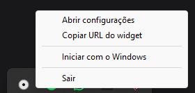
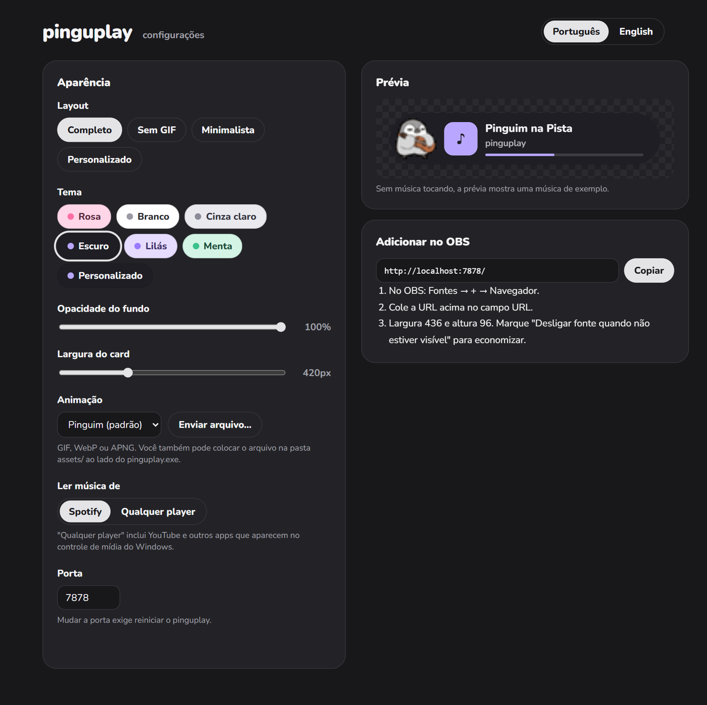
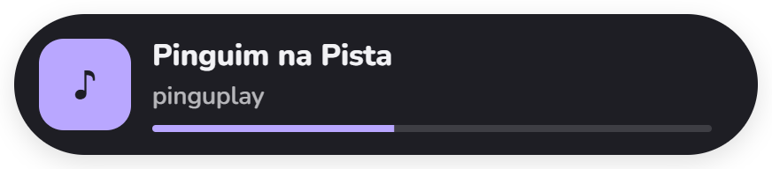
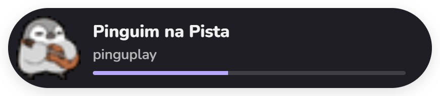
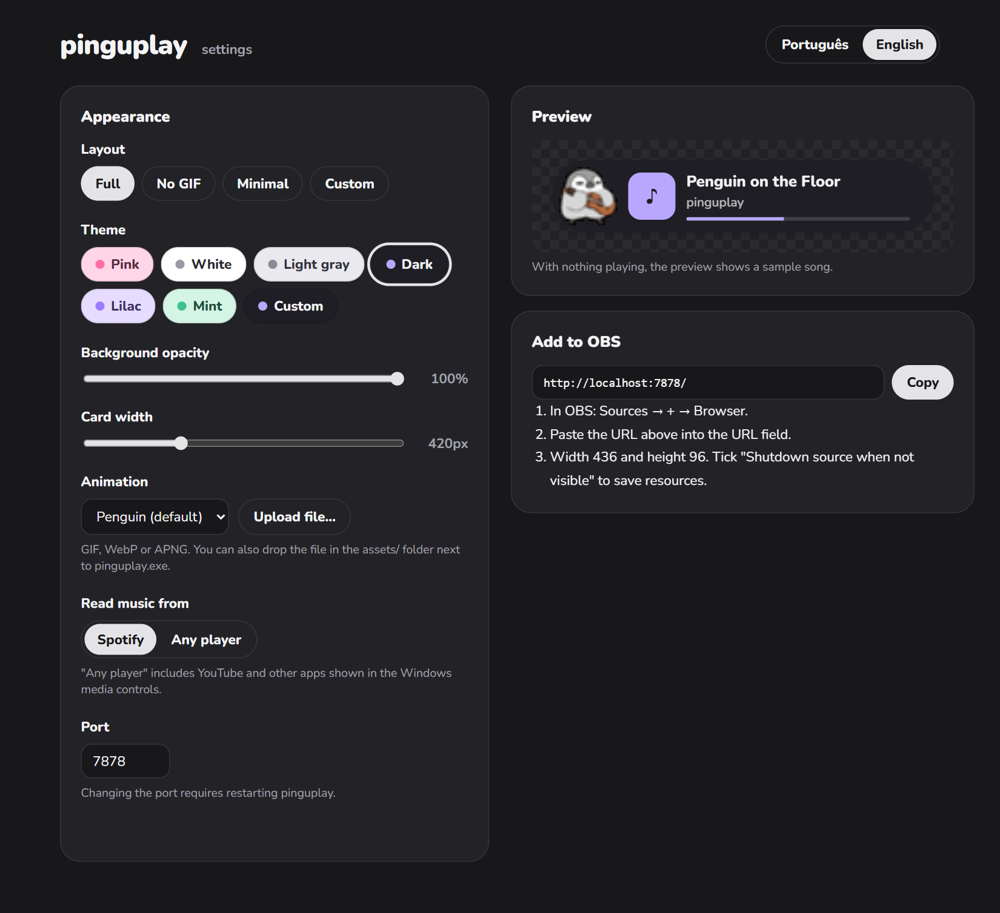
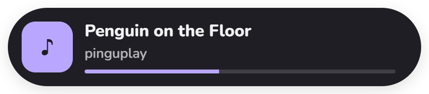
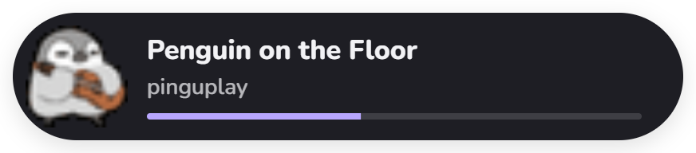

# pinguplay

Now playing widget for OBS (Spotify) · Widget "tocando agora" para OBS (Spotify)


[Português](#português) · [English](#english)

---

## Português

Um card em formato de pílula que mostra a música tocando no Spotify, com um pinguim animado que dança enquanto a música toca e congela quando você pausa.

- **Sem login**: lê a música pelo controle de mídia do Windows. Não precisa de conta de desenvolvedor nem de token do Spotify.
- **Leve**: um `.exe` pequeno na bandeja do sistema. O widget usa só CSS para as animações.
- **Fácil de configurar**: página de configurações com prévia ao vivo. O OBS atualiza sozinho.
- 4 layouts: **Completo**, **Sem GIF**, **Minimalista** e **Personalizado** (escolha pinguim, capa, artista e barra).
- 6 temas (escuro por padrão, rosa, branco, cinza claro, lilás, menta) + cores personalizadas e opacidade do fundo.
- Tamanho do texto ajustável (80–160%); o card cresce sozinho quando precisa.
- Animação trocável (GIF, WebP ou APNG).

### Requisitos

- Windows 10 ou 11
- App desktop do Spotify no mesmo PC da live
- OBS Studio (ou outro programa com fonte "Navegador")

### Como usar

1. Baixe o zip da página de [Releases](../../releases) e extraia numa pasta.
2. Abra o `pinguplay.exe`. Um ícone de disco cinza aparece na bandeja do Windows.
3. Clique com o botão direito no ícone → **Abrir configurações**. O menu também tem **Copiar URL do widget** e **Iniciar com o Windows**.

   

4. Escolha layout, tema, largura e animação. A prévia mostra o resultado na hora.

   

5. No OBS: **Fontes → + → Navegador**, cole `http://localhost:7878/`. Use a largura e a altura que a página de configurações indica em **Adicionar no OBS**.

#### O Windows mostrou um aviso?

Ao abrir o `.exe`, o Windows pode mostrar **"O Windows protegeu o computador"** (SmartScreen). Isso acontece com programas baixados da internet que não têm assinatura digital, como o pinguplay. Para abrir:

- **Antes de extrair:** clique com o botão direito no `.zip` → **Propriedades** → marque **Desbloquear** → **OK**. Depois extraia normalmente; o aviso não aparece.
- **Ou, no aviso:** clique em **Mais informações** → **Executar assim mesmo**.

### Comportamento

| Situação | Widget |
| --- | --- |
| Tocando | Pinguim animado, barra de progresso andando |
| Pausado | Card continua; pinguim congela (sem pinguim: ⏸ sobre a capa; sem imagem: card translúcido) |
| Anúncio (Spotify free) | "Intervalo ♪" (pinguim congelado, se visível) |
| Spotify fechado | Card some com fade |

### Layouts

| Layout | Pinguim | Capa | Título | Artista | Barra |
| --- | --- | --- | --- | --- | --- |
| Completo | ✓ | ✓ | ✓ | ✓ | ✓ |
| Sem GIF | — | ✓ | ✓ | ✓ | ✓ |
| Minimalista | — | — | ✓ | ✓ | — |
| Personalizado | opcional | opcional | ✓ | opcional | opcional |

Sem pinguim e sem capa, o card vira uma pílula baixa com `Título · Artista` numa linha só.

| | |
| --- | --- |
| **Completo** |  |
| **Sem GIF** |  |
| **Minimalista** |  |
| **Personalizado** (pinguim, sem capa) |  |

### Trocar a animação

Na página de configurações, use **Enviar arquivo…** ou coloque o arquivo na pasta `assets/` ao lado do `.exe` e escolha na lista. Formatos: GIF, WebP, APNG (até 10 MB).

### Configuração manual

Tudo fica em `config.toml`, ao lado do `.exe`. Mudar `port` exige reiniciar o app.

### Compilar

```bash
cargo build --release
```

O executável fica em `target/release/pinguplay.exe`.

---

## English


A pill-shaped card that shows what's playing on Spotify, with an animated penguin that dances while music plays and freezes when you pause.

- **No login**: reads the track from Windows media controls. No Spotify developer account or token needed.
- **Lightweight**: a small tray `.exe`. The widget animates with CSS only.
- **Easy setup**: settings page with live preview. OBS updates by itself.
- 4 layouts: **Full**, **No GIF**, **Minimal** and **Custom** (pick penguin, cover, artist and progress bar).
- 6 themes (dark by default, pink, white, light gray, lilac, mint) + custom colors and background opacity.
- Adjustable text size (80–160%); the card grows on its own when needed.
- Swappable animation (GIF, WebP or APNG).

### Requirements

- Windows 10 or 11
- Spotify desktop app on the streaming PC
- OBS Studio (or any app with a "Browser" source)

### Usage

1. Download the zip from [Releases](../../releases) and extract it.
2. Run `pinguplay.exe`. A gray disc icon shows up in the Windows tray.
3. Right-click the icon → **Open settings**. The menu also has **Copy widget URL** and **Start with Windows**.

   

4. Pick layout, theme, width and animation. The preview updates instantly.

   

5. In OBS: **Sources → + → Browser**, paste `http://localhost:7878/`. Use the width and height shown under **Add to OBS** in the settings page.

#### Did Windows show a warning?

When opening the `.exe`, Windows may show **"Windows protected your PC"** (SmartScreen). This happens with programs downloaded from the internet that aren't digitally signed, like pinguplay. To open it:

- **Before extracting:** right-click the `.zip` → **Properties** → tick **Unblock** → **OK**. Then extract as usual; the warning won't show up.
- **Or, on the warning:** click **More info** → **Run anyway**.

### Behavior

| Situation | Widget |
| --- | --- |
| Playing | Animated penguin, moving progress bar |
| Paused | Card stays; penguin freezes (no penguin: ⏸ over the cover; no image: card dims) |
| Ad (Spotify free) | "Break ♪" (frozen penguin, if shown) |
| Spotify closed | Card fades out |

### Layouts

| Layout | Penguin | Cover | Title | Artist | Bar |
| --- | --- | --- | --- | --- | --- |
| Full | ✓ | ✓ | ✓ | ✓ | ✓ |
| No GIF | — | ✓ | ✓ | ✓ | ✓ |
| Minimal | — | — | ✓ | ✓ | — |
| Custom | optional | optional | ✓ | optional | optional |

With no penguin and no cover, the card becomes a short pill with `Title · Artist` on one line.

| | |
| --- | --- |
| **Full** |  |
| **No GIF** |  |
| **Minimal** |  |
| **Custom** (penguin, no cover) |  |

### Changing the animation

In settings, use **Upload file…**, or drop a file into the `assets/` folder next to the `.exe` and pick it from the list. Formats: GIF, WebP, APNG (up to 10 MB).

### Manual configuration

Everything lives in `config.toml` next to the `.exe`. Changing `port` requires restarting the app.

### Building

```bash
cargo build --release
```

The executable is at `target/release/pinguplay.exe`.

---

MIT License. Nunito font under SIL OFL 1.1.
